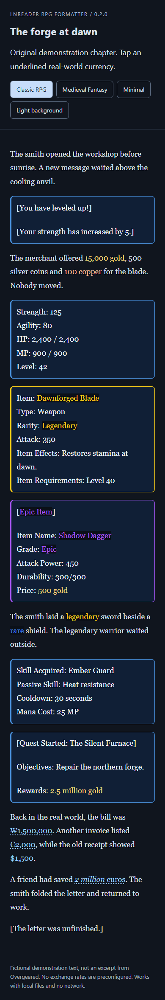
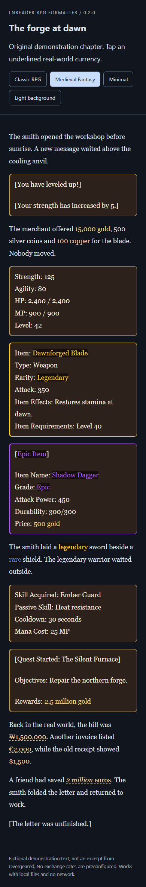
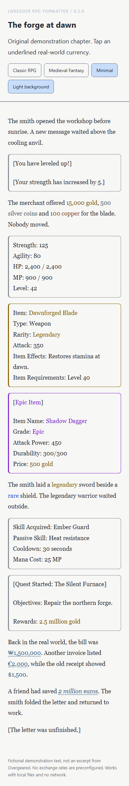

# LNReader RPG Formatter

Formatador de LitRPG em inglês para **Custom JavaScript do LNReader Android**, sem alterar o APK. Detecta mensagens de sistema, status, equipamentos, habilidades e quests; aplica três temas e destaca moedas preservando o texto original.

**v0.2.0:** bundles prontos em [dist/](dist/), agora com raridade de itens e perfis configuráveis. Funciona offline por padrão, sem dependências de execução. Integração baseada no código oficial do LNReader; testes em Chromium concluídos, **validação em um aparelho Android ainda pendente**. Não é um projeto oficial do LNReader.

## Aparência

| Classic RPG | Medieval Fantasy | Minimal claro |
| --- | --- | --- |
|  |  |  |

As imagens são capturas da [demonstração interativa](fixtures/preview.html), com texto fictício original. Não reproduzem capítulos de Overgeared. A demonstração permite trocar tema e fundo e testar os valores tocáveis.

## Instalação no Android

1. Transfira [dist/lnreader-rpg.js](dist/lnreader-rpg.js) para o aparelho. O arquivo `.min.js` é uma alternativa menor, com o mesmo comportamento. Instale **um deles**.
2. No LNReader, abra **Settings → Custom Code** e crie um snippet **JavaScript**. Os nomes traduzidos podem variar; no código inspecionado, a tradução pt-BR de Custom JS está incorretamente igual à de CSS. Confirme que o editor está na linguagem `js`.
3. No editor, use o ícone **Import code** (arquivo) e selecione o `.js`. Salve, dê um nome como `RPG Formatter` e mantenha o snippet ativo.
4. Reabra o capítulo. Mensagens como `[You have leveled up!]` devem receber uma janela; toque em `₩1,500,000` ou `€2,000` para abrir o diálogo.

O importador utiliza o MIME `application/javascript`. Se o gerenciador de arquivos ocultar o arquivo, abra o `.js` em um editor de texto, copie **todo** o conteúdo e cole no editor JavaScript do LNReader. Não cole uma URL, um elemento `<script>` ou cercas Markdown. Em versões antigas com apenas um campo Custom JS, use esse campo e reabra o capítulo.

Os estilos já estão incorporados. [dist/lnreader-rpg.css](dist/lnreader-rpg.css) também é fornecido para consulta/customização no Custom CSS, mas **CSS sozinho não faz detecção**. Não é necessário instalar os dois tipos de arquivo.

A tela de importação e o mecanismo de execução foram confirmados no [código oficial](https://github.com/lnreader/lnreader/blob/14d87add614960b5d1f300092339fa191399c393/src/screens/settings/SettingsCustomCodeScreen/CodeSnippetsScreen.tsx#L109). A versão instalada no aparelho pode ter outra interface. Consulte a [investigação completa](docs/INVESTIGATION.md).

## Configuração

Adicione este trecho **antes do bundle**, no mesmo snippet JavaScript. Assim a configuração acompanha o arquivo importado e não depende de armazenamento do navegador.

```js
window.LNReaderRPGConfig = {
  theme: "classic", // "classic", "medieval" ou "minimal"
  enabled: true,
  currencyHighlight: true,
  currencyConversion: true,
  onlineRates: false,
  rarity: { enabled: true, profile: "default" },
  exchangeRates: { USD: 1, KRW: null, EUR: null }
};
// Abaixo: todo o conteúdo de dist/lnreader-rpg.js
```

| Opção | Efeito |
| --- | --- |
| `theme` | Classic azul, Medieval marrom/dourado ou Minimal integrado ao fundo/texto do leitor. |
| `enabled` | Desativa ou ativa toda a formatação. |
| `currencyHighlight` | Controla o destaque geral de moedas, incluindo fictícias e USD. |
| `currencyConversion` | Controla a interação de KRW/EUR; continua funcionando se apenas o destaque geral estiver desativado. |
| `onlineRates` | Permite consulta opcional de cotações; padrão `false`. |
| `rarity` | Habilita raridades e seleciona um perfil com vocabulário e cores próprios. |
| `rootSelector` | Padrão confirmado: `#LNReader-chapter`. Só altere para adaptar outro HTML; não há fallback para `body`. |

Não há botão flutuante de configuração no capítulo. Isso evita ocupar os controles de leitura. A interface de demonstração é apenas para preview.

Para integradores ou console de desenvolvimento, a API **deste projeto** é:

```js
window.LNReaderRPG.configure({ theme: "medieval" });
window.LNReaderRPG.refresh();
window.LNReaderRPG.getConfig();
window.LNReaderRPG.destroy();
```

`configure` vale para o documento atual; para persistir, edite `LNReaderRPGConfig` no snippet. `destroy` remove estilos, spans, observador e listeners do formatador, preservando o texto. Esses nomes não são APIs nativas do LNReader.

## Raridade de itens

A detecção está ativa por padrão. Campos explícitos `Item Rating`, `Rating`, `Rarity` e `Grade` têm prioridade sobre cabeçalhos como `[Legendary Item]` e `[Mythic Equipment]`. A janela recebe a borda correspondente, e os valores de raridade, cabeçalhos e nomes de itens identificados com segurança recebem destaque. O fundo da janela continua sendo o do tema.

| Raridade | Cor padrão | Variável CSS |
| --- | --- | --- |
| Common | `#9CA3AF` | `--rpg-rarity-common` |
| Uncommon | `#22C55E` | `--rpg-rarity-uncommon` |
| Rare | `#3B82F6` | `--rpg-rarity-rare` |
| Epic | `#A855F7` | `--rpg-rarity-epic` |
| Unique | `#F97316` | `--rpg-rarity-unique` |
| Legendary | `#FACC15` | `--rpg-rarity-legendary` |
| Mythic | `#EF4444` | `--rpg-rarity-mythic` |

Por exemplo, um bloco com `Item Name: Failure`, `Rating: Legendary`, `Attack Power: 1,000` e `Durability: 500/500` recebe borda dourada e destaca `Failure` e `Legendary`. Funciona em um bloco com `<br>` ou em parágrafos consecutivos. Um novo nome ou cabeçalho de item começa outra janela; a raridade não passa para o item seguinte. Nomes soltos, sem rótulo ou cabeçalho inequívoco, não são adivinhados.

Em `Grid obtained a legendary sword.`, somente `legendary` recebe destaque. `He was a legendary warrior.`, nomes de habilidades, classes e títulos não recebem classificação de equipamento. As regras contextuais exigem um substantivo de equipamento imediatamente após a raridade; associações indiretas, negação simples e compostos como `legendary sword master` são ignorados.

Os detectores retornam a raridade, o nome seguro quando disponível, a origem e intervalos exatos do texto. A confiança é uma **pontuação de regra, não uma probabilidade**: `1` para campo explícito exato, `0.95` para cabeçalho de equipamento e `0.8` para contexto com substantivo adjacente. Somente campos/cabeçalhos classificam uma janela inteira. Campos conflitantes ou valores desconhecidos causam abstenção; não existe a regra de escolher a raridade “maior”.

### Temas e cores

As cores padrão são preservadas nos temas escuros, com um fundo discreto sob os termos para manter legibilidade. No Minimal claro, tons mais escuros das mesmas cores permitem destaque sem esse fundo. Nenhum efeito animado ou glow foi adicionado. A paleta padrão passou por verificações de contraste de texto nos três temas; cores personalizadas devem ser escolhidas considerando o fundo usado.

Para mudar somente uma cor por tema, use Custom CSS:

```css
[data-rpg-theme="medieval"][data-rpg-tone] {
  --rpg-rarity-legendary: #E8C875;
}
```

Também é possível ajustar `--rpg-rarity-text-background`. As regras ficam em [src/themes/rarity.css](src/themes/rarity.css), sem misturar estilos e detecção. Overrides de cores configurados via JavaScript têm prioridade sobre as variáveis CSS por serem aplicados no elemento raiz.

### Perfis de novel

Não há hierarquia universal nem identificação automática da novel. Escolha o perfil no snippet. Este exemplo cria um perfil chamado `overgeared` usando o vocabulário padrão e ajusta suas cores; o nome do perfil não implica uma tabela canônica de raridades daquela obra:

```js
window.LNReaderRPGConfig = {
  theme: "classic",
  rarity: {
    enabled: true,
    profile: "overgeared",
    profiles: {
      overgeared: {
        fields: ["Item Rating", "Rating", "Rarity", "Grade"],
        colors: { legendary: "#FACC15" },
        themeColors: { minimal: { legendary: "#C09020" } }
      }
    }
  }
};
// Abaixo: o bundle JavaScript completo.
```

Cada perfil pode personalizar:

- `aliases`: mapa de termos para identificadores de raridade; **substitui** o mapa padrão quando fornecido. Exemplo fictício: `{ Ordinary: "common", Relic: "relic" }`.
- `fields`: lista de rótulos reconhecidos, por exemplo `["Quality", "Item Grade"]`; substitui a lista padrão.
- `itemNouns`: substantivos aceitos em cabeçalhos e contexto; por exemplo `["wand", "wands", "equipment"]`. Inclua singular e plural desejados. Substitui a lista padrão.
- `colors`: cores hexadecimais `#RRGGBB` por identificador. Para uma raridade nova, forneça também sua cor, como `{ relic: "#2DD4BF" }`.
- `themeColors`: ajustes por `classic`, `medieval` ou `minimal`, com prioridade sobre `colors`.

Propriedades omitidas herdam os padrões. As expressões são construídas a partir de termos literais, sem executar regex ou código fornecido pelo perfil. Não há inferência de equivalência ou ordem entre raridades de obras diferentes.

Para desativar só esta funcionalidade: `rarity: { enabled: false }`. O destaque monetário e as janelas continuam funcionando. `window.LNReaderRPG.configure({ rarity: { profile: "default" } })` troca o perfil no documento atual; para persistir alterações, edite o snippet e reabra o capítulo.

## Moedas e conversão

| Texto reconhecido | Comportamento |
| --- | --- |
| `15,000 gold`, `500 silver coins`, `100 copper`, `2.5 million gold` | Cor dourada, prateada ou cobre. Sem botão, sublinhado ou conversão. |
| `₩1,500,000`, `500,000 won`, `100,000 KRW` | Toque para consultar conversão de KRW para USD. |
| `€2,000`, `2 million euros`, `20 EUR` | Toque para consultar conversão de EUR para USD. |
| `$1,500`, `500 USD`, `20 US dollars` | Destaque somente; sem conversão redundante. |

O parser usa convenções inglesas: vírgula para milhares, ponto decimal e multiplicadores `thousand`, `million`, `billion`. `$` e `dollars` são tratados como USD nesta versão. Formatos ambíguos/malformados, negativos e montantes acima do limite numérico seguro são ignorados. Não interpreta taxas de troca entre moedas do jogo.

**Gold, Silver e Copper nunca são convertidos.** KRW e EUR sem taxa mostram exatamente `Exchange rate unavailable.`. O texto da novel, inclusive símbolos e separadores, permanece intacto.

### Taxas manuais e modo offline

Nenhuma cotação KRW/EUR vem preenchida. Substitua `null` por um objeto `{ value, date }`, em que:

- `value` é um número positivo com **USD por uma unidade da moeda original**.
- `date` é a data real da cotação em `YYYY-MM-DD`, ou `null` se desconhecida. Nesse caso o diálogo informa que a data manual não foi fornecida.

Se sua fonte apresentar KRW por USD, inverta esse valor antes de preencher. A fórmula aplicada é `montante original × value`. Use uma cotação verificada por você; os valores sintéticos nos testes servem apenas para verificar aritmética. Taxas manuais têm precedência sobre as online.

### Taxas online, opcionais

Defina `onlineRates: true` para consultar [Frankfurter/ECB](https://frankfurter.dev/), com o endpoint fixo `https://api.frankfurter.dev/v2/providers/ecb/rates?base=USD&quotes=KRW,EUR`. A resposta em base USD é invertida; o diálogo mostra a data do provedor, nunca a data do download como se fosse a da cotação.

A consulta acontece na inicialização ou ao receber o evento `online`, com cache de seis horas, deduplicação e intervalo mínimo de cinco minutos entre tentativas. Não consulta por valor encontrado. Há timeout de cinco segundos; falhas mantêm a última cotação válida. Valores antigos continuam disponíveis com sua data original.

O cache persistente só é usado depois de testar escrita/leitura/remoção em `localStorage`. Se indisponível, usa memória durante aquele documento. Cache depende da origem do capítulo e pode não ser compartilhado entre capítulos online e baixados. No modo padrão offline, o módulo não acessa rede nem armazenamento.

O endpoint foi consultado no ambiente de desenvolvimento; isso não comprova CORS/fetch na WebView do aparelho. Por esse motivo o modo online permanece desativado por padrão. Se uma taxa chega depois de abrir o diálogo, feche e abra o valor novamente.

## Detecção e preservação

As regras reconhecem notificações conhecidas entre colchetes, atributos com valores numéricos e campos rotulados de itens/quests/habilidades. Colchetes isolados e menções narrativas a força, espadas ou quests não bastam para criar uma janela.

Parágrafos irmãos consecutivos do mesmo tipo compartilham bordas e fundo; novos nomes/cabeçalhos de itens também delimitam grupos. Não são movidos para novos contêineres. Um parágrafo narrativo, texto solto ou `<br>` entre blocos interrompe o agrupamento. Textos dentro de `<em>` e `<strong>` permanecem no mesmo elemento; moedas e raridades podem atravessar essas tags.

A inicialização é adiada porque o LNReader reatribui o HTML após executar Custom JS. O formatador nunca reatribui `innerHTML`: usa nós de texto, `TreeWalker`, `splitText`, spans e classes. Um único `MutationObserver` agrupa alterações, fica desconectado durante o trabalho próprio e aguarda o fim de uma seleção antes de modificar o capítulo. Reinjetar o bundle reutiliza a instância.

Em rolagem vertical, a posição do primeiro parágrafo visível é compensada após mudanças de layout. No modo de colunas do host, não são alteradas margens/padding dos parágrafos. O diálogo é não modal: sem backdrop, sem bloqueio de rolagem, com fechamento por botão, Escape ou toque fora. Apenas cliques de conversão e dentro do diálogo são isolados do `document.onclick` do leitor; gestos de toque/rolagem não são cancelados.

## Build, testes e preview

Requer Node.js 22 ou superior; validado com Node 24. No PowerShell com scripts bloqueados, use `npm.cmd`/`npx.cmd` no lugar de `npm`/`npx`.

```sh
npm ci
npx playwright install chromium
npm run check
npm run preview
```

Abra `http://127.0.0.1:4173`. Também pode abrir `fixtures/preview.html` diretamente após o build, inclusive offline.

Comandos individuais: `npm run typecheck`, `npm test`, `npm run build`, `npm run test:browser`. O build gera:

```text
dist/lnreader-rpg.js       # IIFE legível, com CSS incorporado
dist/lnreader-rpg.min.js   # Mesmo bundle minificado
dist/lnreader-rpg.css      # Temas e estilos separados
dist/SHA256SUMS.txt        # Verificação de integridade
```

O target de sintaxe é Chromium 61; a validação executada usa Chromium atual. Isso não equivale a uma certificação em WebViews antigas. O bundle não usa imports de runtime, bibliotecas externas, `eval()` ou `new Function()`.

Veja [VALIDATION.md](docs/VALIDATION.md) para testes executados e verificações pendentes no Android. As capturas em `docs/images/` são regeneradas pelo teste de preview.

## GitHub, atualização e rollback

Repositório: [Lucas-Maransaldi/lnreader-rpg-formatter](https://github.com/Lucas-Maransaldi/lnreader-rpg-formatter). Os arquivos prontos para importar ficam em [GitHub Releases](https://github.com/Lucas-Maransaldi/lnreader-rpg-formatter/releases).

1. Mantenha fontes, `package-lock.json` e `dist/` versionados. `.research/` contém apenas clones locais de investigação e está ignorado.
2. Atualize a versão em `package.json` e `src/core/bootstrap.ts`, sincronize o lockfile com `npm install --package-lock-only`, escreva o changelog e rode `npm run check`.
3. Faça commit dos arquivos e crie/envie uma tag semântica, como `v0.2.0`.
4. O workflow `Release` confere a versão, testa, reconstrói, verifica `dist/` e publica os três arquivos, checksums e um ZIP do projeto. A CI também verifica PRs e pushes em `main`/`master`.

Para atualizar no Android, guarde uma cópia do snippet atual e sua configuração. Baixe o `.js` da versão desejada, **substitua** o conteúdo do snippet, restaure a configuração e reabra o capítulo. Evite dois snippets ativos com versões diferentes. Para rollback, importe o arquivo da release anterior e reabra o capítulo. Para remover, desative o snippet.

Não há instalação automática por URL nem loader jsDelivr nesta versão. A interface inspecionada importa arquivos; suporte confiável a scripts HTTPS remotos na WebView não foi demonstrado. Veja a [decisão de distribuição remota](loader/README.md).

## Solução de problemas e limites conhecidos

| Sintoma | Verificação |
| --- | --- |
| Nada mudou | Confirme linguagem JS, snippet ativo, arquivo completo e reabertura do capítulo. Textos narrativos comuns continuam iguais. |
| Erro ao colar | Remova cercas Markdown e tags HTML. Use o bundle, não os fontes TypeScript. |
| Taxa indisponível | É o padrão esperado: configure uma taxa manual ou habilite/teste o modo online. |
| Alguns blocos não são detectados | As regras priorizam precisão. Envie um exemplo mínimo de HTML original para ampliar os detectores. |
| Outra customização conflita | Teste com somente este snippet e reabra o capítulo; scripts que reescrevem continuamente o HTML podem competir. |
| Tema Minimal não acompanha o fundo | O host deve disponibilizar as variáveis CSS observadas; teste `refresh()` ou reabra o capítulo em versões diferentes. |
| Arquivo não aparece no importador | Verifique extensão `.js` e MIME; use copiar/colar como alternativa. |

Limitações da primeira versão:

- Inglês, convenções numéricas inglesas e somente as moedas listadas. Homônimos e contexto financeiro implícito não são resolvidos por um modelo de linguagem.
- Detecta blocos existentes (`p`, `li`, `div` folha, células, etc.) e linhas internas com `<br>`. Não transforma mensagens espalhadas por um grande bloco misturado à narrativa nem cria parágrafos para texto solto na raiz.
- Links, código, campos editáveis, botões e elementos com `data-rpg-ignore` são preservados sem destaque.
- TTS, busca do host, gestos nativos, mudanças de fonte/imagens e restauração de progresso entre sessões dependem de validação no Android. A preservação de texto e os testes de desktop não cobrem essas integrações nativas.
- As taxas refletem a data consultada/configurada, não necessariamente o período histórico da história. Cache antigo não é atualizado sem rede/evento de atualização.
- O cache não oferece persistência garantida entre origens. O modo local com taxas manuais é a opção independente de rede/armazenamento.

## Organização e contribuição

`src/core/` gerencia configuração e DOM, incluindo os intervalos de texto compartilhados por moedas e raridades; `src/detectors/` classifica blocos e evidências de raridade; `src/formatters/rarity-formatter.ts` aplica a classificação; `src/currency/` separa reconhecimento, destaque, cotação e diálogo; `src/themes/` contém os temas. `tests/unit/` cobre regras e DOM; `tests/browser/` testa bundles e o contrato de Custom JS. Acrescente fixtures originais e testes de falso positivo ao ampliar os detectores.

Licença [MIT](LICENSE). Veja também [CHANGELOG.md](CHANGELOG.md).
